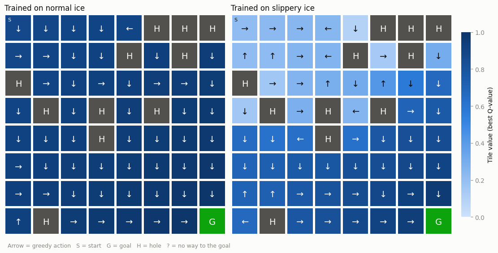

# Q-Learning on FrozenLake 8x8: Slippery vs. Normal Ice

Two tabular Q-learning agents learn the same random 8x8 FrozenLake map:
- **Normal ice:** every move goes where the agent wants.
- **Slippery ice:** a move goes the intended way only 1 time in 3.

Each agent is then tested on both kinds of ice.

## Replays

**Normal ice**


https://github.com/user-attachments/assets/74e90100-5d50-4c79-a6f3-9c80c4c27878


**Slippery ice** (a winning game; the results below show the real win rate)


https://github.com/user-attachments/assets/0bccdb30-2227-4217-b491-74dc7977e301


## What each agent learned



The arrow is the action the agent picks on each tile. Darker tiles have higher values.

## Results (1,000 test games each)

```
Normal agent on normal ice:      Mean_reward=1.00 +/- 0.00 

Slippery agent on slippery ice:  Mean_reward=0.34 +/- 0.48
```

## Code

Full notebook: [frozenlake_qlearning_two_agents.ipynb](frozenlake_qlearning_two_agents.ipynb)

Also on Hugging Face: [Ebishj/frozenlake-q-learning-slippery-vs-normal-8x8](https://huggingface.co/Ebishj/frozenlake-q-learning-slippery-vs-normal-8x8)

Built on Unit 2 of the [Hugging Face Deep RL Course](https://huggingface.co/learn/deep-rl-course/unit2/introduction).
